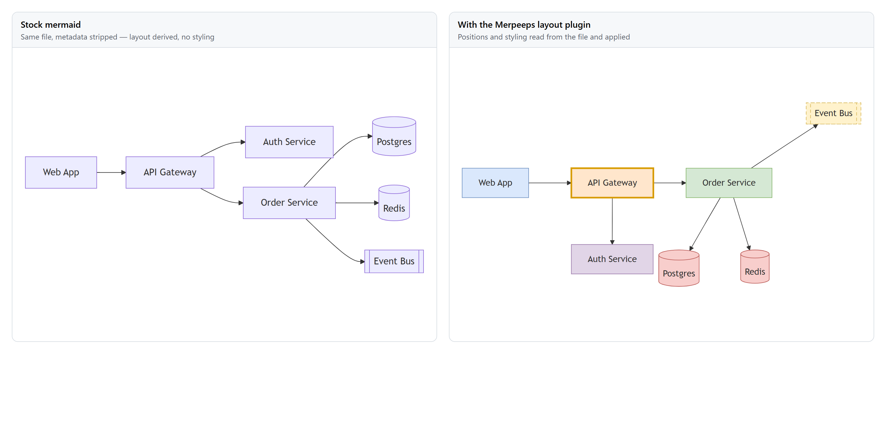
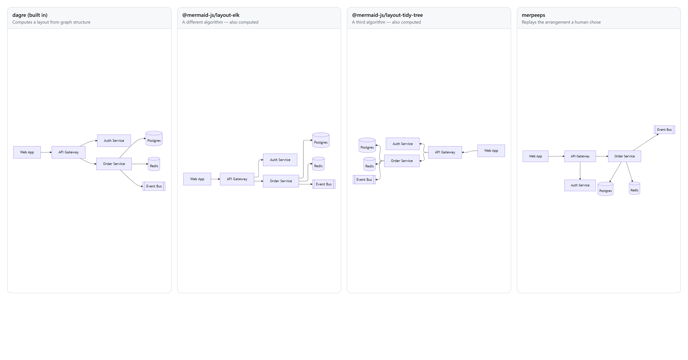

# Merpie


**Layout and styling for Mermaid diagrams, stored inside the diagram file.**

Mermaid has no coordinate system — you describe a graph and the renderer decides
where the boxes go, so "put this box *here*" cannot be said. Merpie lets you
place them yourself and keeps those positions, plus colours and icons, in the
same `.mmd` file under a key stock renderers ignore.

The file still renders correctly on GitHub with nothing installed. It renders
*your* arrangement anywhere the Merpeeps layout plugin is present.

The GUI is now **Merpie**, with the approved sea-magpie mascot and matching app
icon. Its executable is `Merpie.App` (`Merpie.App.exe` on Windows). The repository
and source project paths, `x-merpeeps` file keys, `merpeeps` CLI/MCP names and
Merpeeps shared-library/package IDs remain compatible; existing diagrams need no
migration. The launcher still accepts old `Merpeeps.App` installations.


## Try it

```bash
git clone https://github.com/sargeMonkey/merpeeps.git
cd merpeeps
dotnet run --project src/Merpeeps.App -- docs/styled-sample.mmd
```

Needs the .NET 10 SDK. Drag the boxes around, save, and look at the file.
Launch without a filename to open the visual **Create a diagram** gallery.
Choose from the 33 diagram families in the pinned Mermaid 12 catalog to start
empty, or open an existing file. The preview tiles illustrate the types; they
do not insert samples. Editors use each family's own data: grammar expressions,
timeframes, sets, responsibility lanes or nested calls rather than substitute
flowchart nodes.

The preview release pipeline produces versioned **Windows x64**, **Linux x64**,
**Intel Mac x64** and **Apple Silicon Mac arm64** portable downloads with approved icons, bundled
brand assets and platform metadata. Windows opens `app/Merpie.App.exe`; Linux
uses the `merpie` launcher; macOS opens `Merpie.app`. These are unsigned,
runtime-bundled packages, not automatic installation or public publication.
See [deployment packaging](docs/GUIDE.md#merpie-desktop-packaging).

The current release candidate is **0.1.0-preview.2**, deliberately draft/prerelease until
platform acceptance and signing are completed. NuGet and npm companion artifacts
are attached, not automatically pushed to registries. The JavaScript companion
supports metadata/layout replay; it is **not a port of all C# typed editors**.
See [release process and limitations](docs/RELEASING.md) and
[family support](docs/DIAGRAM-SUPPORT.md).

Inherited diagram labels adapt to actual light/dark and translucent surfaces
without rewriting authored colors. SVG export offers document/light/dark
appearance independently of a transparent outer canvas; CLI SVG and offline
preview accept `--transparent`. Static output does not recolor with its host.

Family availability does **not** mean every upstream feature has native parity.
Unsupported constructs are preserved or explicitly refused, and native
accessibility and external-viewer acceptance remain in progress.

**→ [User guide](docs/GUIDE.md)** — installing, first steps, sharing diagrams,
troubleshooting.

## What ends up in your file

```yaml
---
x-merpeeps:              # Merpeeps's block. Stock renderers never see this.
  spec: 1
  layout:
    nodes:
      web: {x: 60, y: 0}
  style:
    nodes:
      web: {fill: '#DAE8FC', icon: browser}
---
flowchart TD           # Your diagram, untouched.
    web[Web Client] --> gw{{API Gateway}}
```

Mermaid's frontmatter parser reads only `displayMode`, `title` and `config` —
everything else is discarded before its parser runs. That is not a hopeful
assumption: it is checked against real Mermaid 12.0.0 across 32 bundled diagram families on
every commit.

Edits are surgical, too. Renaming one node changes one line, so your comments
and formatting survive and a diff shows what you actually did.

## Something has to draw it

```js
import mermaid from 'mermaid';
import { registerMerpeepsLayout } from 'merpeeps-mermaid-layout/mermaid';

registerMerpeepsLayout(mermaid);
```



Same file, both sides. On the left the metadata is stripped and mermaid derives a
layout; on the right the stored positions and colours are applied exactly.

The layout choice is injected **in memory only**, never written to the file — a
document that depends on a plugin being installed is the lock-in this format
exists to avoid. Diagrams with no stored positions fall straight through to
mermaid's own layout, so the result is never worse than stock.

## Not a competitor to the official layout plugins



One file, four engines. The first three **compute** an arrangement from the
graph's structure — and each reaches a different conclusion. Tidy-tree is
confident enough to reverse the whole diagram right-to-left. None of them is
wrong; they simply cannot know what the author meant, because the file never
said.

Merpeeps is the fourth column. It **replays** an arrangement a person chose. There
is no algorithm in it at all.

## Where the plugin isn't installed

GitHub, GitLab and Notion embed mermaid as-is, so almost nowhere has the plugin.
`merpeeps bake` rewrites your colours as native `style` statements, giving a file
that renders them unaided — and tells you what it could not carry, because
positions and icons have no equivalent in mermaid syntax.

## Agents can write these files

An MCP server and a CLI expose the same twelve operations, so an agent or a
script can compose a diagram, style it, and lay it out:

```bash
merpeeps capabilities diagram.mmd # native support, not a syntax check
merpeeps edit diagram.mmd --write --ops '[{"op":"addNode","id":"cache","label":"Redis"}]'
merpeeps layout diagram.mmd --engine tree --write
merpeeps open diagram.mmd          # hand it to a person
```

That last line is the point. Structure, colour and icons follow from what a
diagram means, so a program can choose them. Where a node belongs on the page is
a judgement — so the end of an automated workflow is a window, not a guess.

## Packages

| Package | Registry | What it is |
|---|---|---|
| [`merpeeps-mermaid-layout`](packages/merpeeps-mermaid-layout) | npm | JavaScript implementation, plus the mermaid layout plugin |
| `Merpeeps.Core` | NuGet | C# implementation — parsers, layout, edit commands, the surgical writer |
| [`Merpeeps.Render`](src/Merpeeps.Render) | NuGet | Offline reference rendering and real Mermaid syntax-validation assets for native hosts |
| [`Merpeeps.Scene`](src/Merpeeps.Scene) | NuGet | Shared visual-object definitions, geometry, styling and content references for Markdown-backed editors |

```bash
npm install merpeeps-mermaid-layout
dotnet add package Merpeeps.Core
```

The C# and JavaScript diagram implementations are held to a **shared conformance
suite run against real mermaid.js**. The oracle imports the *installed*
npm package rather than a copy of its source, which means the artefact that ships
is the artefact that was verified.

Publishing the format separately from the editor is deliberate. A layout scheme
is only worth anything if more than one tool agrees to it, and an editor-specific
format helps nobody.

`Merpeeps.Scene` uses a separate `x-merpeeps-scenes` envelope, with one scene per
visual surface. MerDeck uses it for slide objects while keeping deck order and
Markdown content. Existing diagram `x-merpeeps` metadata is unchanged. The first
scene version supports text and nested diagrams; see [the scene contract](docs/SCENES.md).

## Status

Nothing is published yet, so the format is still free to change.

Working: the format, the editor, six layout engines, styling and icons, stencil
packs, SVG and baked export, a NativeAOT CLI, an MCP server for agents, and
metadata round-tripping across Mermaid 12.0.0's 32 bundled reference-rendered
diagram families. ZenUML reference rendering is not included.

Native editing and SVG cover flowchart/graph, state, class, ER and sequence
diagrams; Pie, Quadrant, XY and Radar charts; Timeline and User Journey;
Mindmap and Tree View; Packet/Kanban; Requirement/GitGraph; Sankey/Treemap;
Block/Architecture; C4/Gantt; and Wardley/Ishikawa/Cynefin. These data, temporal, hierarchy and
board families use their own models/layouts—not graph-node substitutions.
The remaining Mermaid families are still under implementation.
Other families open as source-only documents with a diagnostic; they are not
silently interpreted as flowcharts. Metadata remains type-agnostic, and the
reference Mermaid renderer can preview other supported Mermaid types.

`merpeeps validate` checks metadata round-tripping, **not Mermaid syntax**.
Use `merpeeps capabilities` before native operations. Other native diagram families
and complete all-family structural authoring are not built yet.

**File > New diagram...** opens the same visual gallery used at startup.
Click a type's preview tile to create it; **Other syntax…** exposes legacy and
alternate directives separately. Unsaved work is kept until you explicitly
confirm replacement, and **Back to diagram** restores the current editor.
Unavailable native types are clearly listed as not yet implemented.

The desktop UI uses the Amplify Studio theme: light white/mist and dark ink
surfaces, flat volt accents, bundled Instrument Sans controls, Archivo headings,
and IBM Plex Mono source. It retains ordinary menus rather than a ribbon.
The narrow left rail is pictorial; hover or keyboard-focus a tool for its name.
The layers button opens a navigable outline, and the plus button returns to
creation. Select an object to edit its name directly; the sliders button beside
it reveals secondary properties. Icon actions keep the same keyboard and
screen-reader names. App theme changes never write diagram styling to the file.

The left item palette follows the document's actual type for every catalog
family. Each item has a pictorial stencil: click it to create an element
immediately with a unique name and valid defaults, then edit it on the right.
Each insertion is one undo step. Required owners (for example a column for a
card or an actor for an attached note) are explained by disabled-item hints.
Creation stays on the left; selecting an object or relationship shows its
editable properties directly on the right, without a Rename/Edit step.
Names and frequently used fields stay visible; identity, appearance and
other secondary settings use collapsible sections. Enter or leaving a text
field commits a valid edit; multiline fields use Ctrl+Enter. Dropdowns and
checkboxes apply their selection directly. Escape cancels the pending edit,
and each committed change can be undone. Invalid values remain visible with
an error and do not change the diagram.
With no selection the properties panel shows a short prompt,
not a collection of creation forms. Source is collapsed by default; use
**Source** in the status bar or **View > Show source pane** to open it.
Diagram-wide titles, display settings, navigation, alignment and reference time
belong to the **Diagram** menu, not the stencil collection. Explicit custom
creation forms remain available from **Diagram > Add...**.
Pane visibility is a window preference and never changes the diagram.

Color fields open full-range picker dialogs with a wheel, brightness, exact
RGB channels and hex entry. All 16,777,216 RGB colors are available; typed
diagram color fields also support 256 alpha levels. Cancel leaves the document
unchanged, Use default clears the override, and invalid input cannot confirm.
Flowchart/state metadata colors remain opaque for renderer compatibility.
Clicking a stencil commits valid inline edits before adding the next element;
invalid edits show feedback instead of leaving an unclickable palette.
The palette no longer offers C4,
Architecture or other stencil categories as if they changed the diagram family.
Flowcharts get flowchart shapes, state diagrams get basic state tools, and
classes get their contextual class inspector. Entity-relationship diagrams use
typed entity tables, PK/FK/UK attribute controls and crow's-foot relationship
cardinalities, including subgraph endpoints and self/parallel routes.

The class inspector follows the canvas selection instead of presenting every
editing form at once. Choose **Class** in the left palette to start a new card. Select
a card to rename it, add attributes/methods or start **Add relationship**, then
click its target on the canvas. Select a relationship to change only its type,
ends, multiplicities and label. Escape cancels connection targeting.

Member details appear only while adding or editing a member. More class actions
holds generics, annotations, namespace assignment, size, notes and interfaces;
the **Diagram** menu contains general creation, namespace management, display
options and keyboard element navigation. Invalid inline fields and unfinished
creation forms remain recoverable when selection changes. Explicit creation
forms still use Apply/Cancel; existing-object properties commit inline.
Class source stays Mermaid; it is not converted into a flowchart. Card sizes
change only when explicitly requested, and unsupported source styles are diagnosed.

Sequence diagrams have real participant lanes and an ordered interaction tree.
Select a participant to send a message, or use **Diagram > Timeline…** for nested
fragments, branches, notes, activations, numbering and ordering. Lifetimes and
activation spans are derived rather than stored as free-floating graph nodes.
Native policy limits are reported separately from Mermaid syntax errors.

For application developers, Core's `MermaidDiagramCatalog` lists the 33 documented
target families and their dialects. `CreateEmpty` supplies genuine empty drafts
for the current native adapters; catalog membership does not imply editable
support. `Merpeeps.Render` separately validates source with the pinned offline
upstream parser. Syntax validity is distinct from native structural editability,
and this library API does not change the CLI's metadata-only `validate` command.
The validator also includes the pinned standalone ZenUML parser: malformed
ZenUML is checked by its real grammar, not the official adapter's no-op parser.
This adds syntax validation, not a native ZenUML editor or reference preview.

## Documentation

| | |
|---|---|
| [User guide](docs/GUIDE.md) | How to use it |
| [SPEC.md](SPEC.md) | The stored format, and what a reader must do with it |
| [Shared scenes](docs/SCENES.md) | The separately versioned visual-scene format and host integration |
| [Design notes](docs/DESIGN.md) | Why it is built this way, and what was measured rather than assumed |
| [CONTRIBUTING.md](CONTRIBUTING.md) | Building, and how this project decides it is correct |
| [CHANGELOG.md](CHANGELOG.md) | What changed |

## Licence and naming

MIT — see [LICENSE](LICENSE).

Not affiliated with, endorsed by, or sponsored by Mermaid Chart Inc., the Mermaid
open-source project, or The Walt Disney Company. "Mermaid" is used descriptively,
to name the file format these tools read and write.
