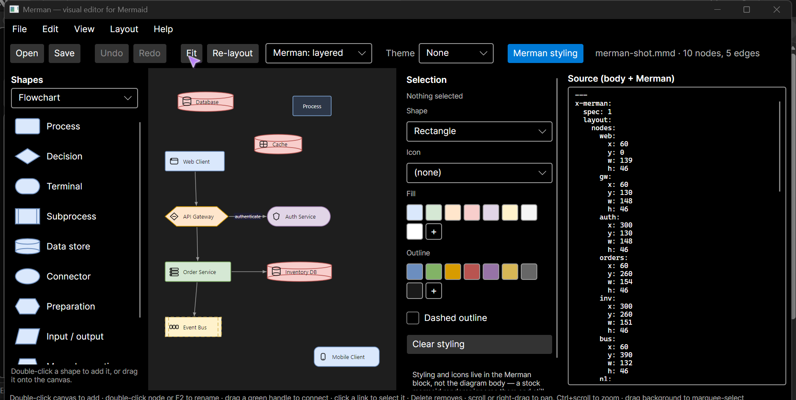

# Merpeeps

**Layout and styling for Mermaid diagrams, stored inside the diagram file.**

Mermaid has no coordinate system — you describe a graph and the renderer decides
where the boxes go, so "put this box *here*" cannot be said. Merpeeps lets you
place them yourself and keeps those positions, plus colours and icons, in the
same `.mmd` file under a key stock renderers ignore.

The file still renders correctly on GitHub with nothing installed. It renders
*your* arrangement anywhere Merpeeps's layout plugin is present.



## Try it

```bash
git clone https://github.com/sargeMonkey/merpeeps.git
cd merpeeps
dotnet run --project src/Merpeeps.App -- docs/styled-sample.mmd
```

Needs the .NET 10 SDK. Drag the boxes around, save, and look at the file.

**→ [User guide](docs/GUIDE.md)** — installing, first steps, sharing diagrams,
troubleshooting.

## What ends up in your file

```yaml
---
x-merpeeps:              # Merpeeps's block. Stock renderers never see this.
  spec: 1
  layout:
    nodes:
      web: {x: 60, y: 0}
  style:
    nodes:
      web: {fill: '#DAE8FC', icon: browser}
---
flowchart TD           # Your diagram, untouched.
    web[Web Client] --> gw{{API Gateway}}
```

Mermaid's frontmatter parser reads only `displayMode`, `title` and `config` —
everything else is discarded before its parser runs. That is not a hopeful
assumption: it is checked against real mermaid.js across 30 diagram types on
every commit.

Edits are surgical, too. Renaming one node changes one line, so your comments
and formatting survive and a diff shows what you actually did.

## Something has to draw it

```js
import mermaid from 'mermaid';
import { registerMerpeepsLayout } from 'merpeeps-mermaid-layout/mermaid';

registerMerpeepsLayout(mermaid);
```


Same file, both sides. On the left the metadata is stripped and mermaid derives a
layout; on the right the stored positions and colours are applied exactly.

The layout choice is injected **in memory only**, never written to the file — a
document that depends on a plugin being installed is the lock-in this format
exists to avoid. Diagrams with no stored positions fall straight through to
mermaid's own layout, so the result is never worse than stock.

## Not a competitor to the official layout plugins


One file, four engines. The first three **compute** an arrangement from the
graph's structure — and each reaches a different conclusion. Tidy-tree is
confident enough to reverse the whole diagram right-to-left. None of them is
wrong; they simply cannot know what the author meant, because the file never
said.

Merpeeps is the fourth column. It **replays** an arrangement a person chose. There
is no algorithm in it at all.

## Where the plugin isn't installed

GitHub, GitLab and Notion embed mermaid as-is, so almost nowhere has the plugin.
`merpeeps bake` rewrites your colours as native `style` statements, giving a file
that renders them unaided — and tells you what it could not carry, because
positions and icons have no equivalent in mermaid syntax.

## Agents can write these files

An MCP server and a CLI expose the same eleven operations, so an agent or a
script can compose a diagram, style it, and lay it out:

```bash
merpeeps edit diagram.mmd --write --ops '[{"op":"addNode","id":"cache","label":"Redis"}]'
merpeeps layout diagram.mmd --engine tree --write
merpeeps open diagram.mmd          # hand it to a person
```

That last line is the point. Structure, colour and icons follow from what a
diagram means, so a program can choose them. Where a node belongs on the page is
a judgement — so the end of an automated workflow is a window, not a guess.

## Packages

| Package | Registry | What it is |
|---|---|---|
| [`merpeeps-mermaid-layout`](packages/merpeeps-mermaid-layout) | npm | JavaScript implementation, plus the mermaid layout plugin |
| `Merpeeps.Core` | NuGet | C# implementation — parsers, layout, edit commands, the surgical writer |

```bash
npm install merpeeps-mermaid-layout
dotnet add package Merpeeps.Core
```

Both are held to a **shared conformance suite run against real mermaid.js**, so
the two implementations cannot drift apart. The oracle imports the *installed*
npm package rather than a copy of its source, which means the artefact that ships
is the artefact that was verified.

Publishing the format separately from the editor is deliberate. A layout scheme
is only worth anything if more than one tool agrees to it, and an editor-specific
format helps nobody.

## Status

Nothing is published yet, so the format is still free to change.

Working: the format, the editor, six layout engines, styling and icons, stencil
packs, SVG and baked export, a NativeAOT CLI, an MCP server for agents, and
round-tripping across all 30 diagram types mermaid can render.

Not built: subgraph authoring, and bespoke editing UI for diagram types beyond
flowchart — Merpeeps itself is type-agnostic, so the other 29 already render and
round-trip, they just have no tailored editor.

## Documentation

| | |
|---|---|
| [User guide](docs/GUIDE.md) | How to use it |
| [SPEC.md](SPEC.md) | The stored format, and what a reader must do with it |
| [Design notes](docs/DESIGN.md) | Why it is built this way, and what was measured rather than assumed |
| [CONTRIBUTING.md](CONTRIBUTING.md) | Building, and how this project decides it is correct |
| [CHANGELOG.md](CHANGELOG.md) | What changed |

## Licence and naming

MIT — see [LICENSE](LICENSE).

Not affiliated with, endorsed by, or sponsored by Mermaid Chart Inc., the Mermaid
open-source project, or The Walt Disney Company. "Mermaid" is used descriptively,
to name the file format these tools read and write. The reasoning, and what the
project deliberately does not do, is in [TRADEMARKS.md](TRADEMARKS.md).
