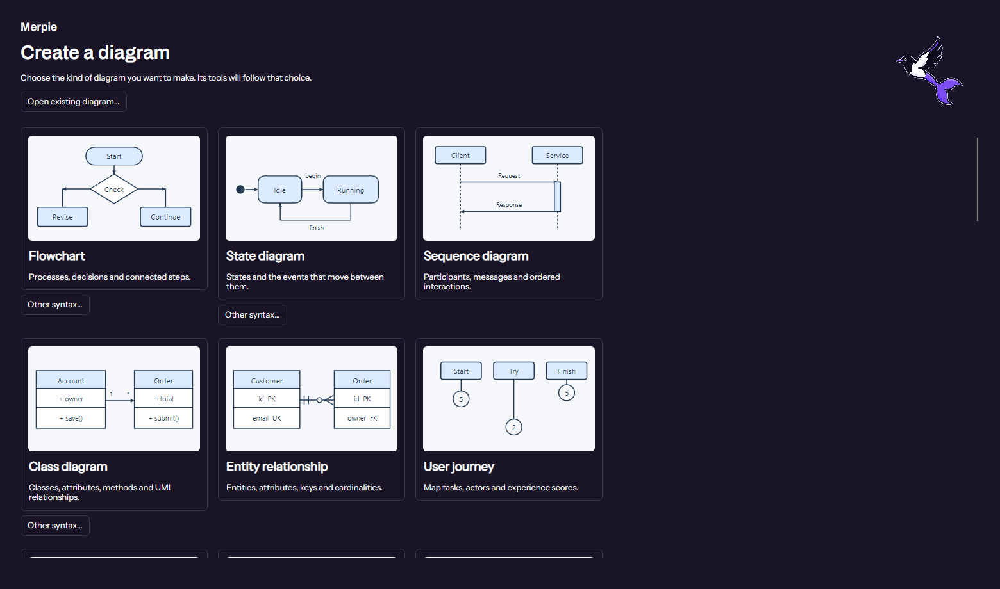

# Merpie user guide

How to actually use it. For *why* it works the way it does, see the
[README](../README.md); for the file format, [SPEC.md](../SPEC.md).

---

## What this is, in three sentences

Mermaid has no coordinate system — you describe a graph and the renderer decides
where the boxes go. Merpie lets you place them yourself and stores those
positions, plus colours and icons, inside the same `.mmd` file under a key stock
renderers ignore. So the file still renders correctly on GitHub with nothing
installed; it just renders *your* arrangement anywhere Merpeeps's layout plugin is
present.

Merpie is the desktop product name. Its shared format/libraries and existing
CLI/MCP commands retain their Merpeeps IDs: `x-merpeeps` metadata, the `merpeeps`
CLI, `MERPEEPS_APP`, and `Merpeeps.Core/Scene/Render` packages. Existing `.mmd`
files do not need migration. The GUI executable is `Merpie.App`, with `.exe` on
Windows; the source project remains `src/Merpeeps.App`.



---

## Getting it running

You need the **.NET 10 SDK**. Nothing else is required for the editor.

```bash
git clone https://github.com/sargeMonkey/merpeeps.git
cd merpeeps
dotnet run --project src/Merpeeps.App -- docs/styled-sample.mmd
```

That opens the sample shipped with the repo. Omitting the filename opens the
visual **Create a diagram** gallery instead; the sample is never inserted
automatically.

Click an available Flowchart, State, Class, ER or Sequence preview to create an empty
document of that type. **Open existing diagram…** opens your own file.
**File > New diagram…** returns to the gallery; **Back to diagram** keeps the
current document, selection and unapplied inspector work. Replacing unsaved
work requires an explicit discard choice. **Other syntax…** below each tile
provides alternate directives without making them look like separate products.

To build a standalone binary instead:

```bash
dotnet publish src/Merpeeps.App -c Release -r win-x64    # or linux-x64, osx-arm64
```

CI already builds these for Windows, Linux and macOS on every push, so if you
would rather not build locally, grab the artefact from the latest green run.

### Merpie desktop packaging

The app uses the locked sea-magpie artwork: the original head/eye and wing streaks
with the broad split mermaid tail. The same app icon appears in the executable,
window, workspace, Linux desktop entry and macOS application bundle. The gallery
and About window use the transparent mascot; dark mode chooses the thin-keyline
variant without changing diagram contents.

Publish, then package the existing output (PowerShell 7.3+ on any CI platform):

```powershell
dotnet publish src\Merpeeps.App -c Release -r win-x64 --self-contained true -o out\app
.\scripts\package-desktop.ps1 -AppPublishPath out\app -RuntimeIdentifier win-x64 -OutputDirectory artifacts\desktop -Version 0.1.0-preview.1 -SelfContained
.\scripts\test-desktop-package.ps1 -PackagePath artifacts\desktop\merpie-0.1.0-preview.1-win-x64 -ArchivePath artifacts\desktop\merpie-0.1.0-preview.1-win-x64.zip
```

Use `linux-x64`, `osx-x64` or `osx-arm64` for the other CI targets. Self-contained
packages bundle .NET but still require native OS libraries. The optional
`-McpPublishPath` includes the published, unchanged `Merpeeps.Mcp` server.
Windows is a ZIP with `app\Merpie.App.exe`; Linux is a tarball with the `merpie`
launcher, `Merpie.desktop` and `icons\merpie.png`; macOS is a tarball containing
`Merpie.app` with its executable, Info.plist and ICNS icon. Packaging sets
executable mode bits in tar archives even when cross-publishing from Windows.
All packages include a hashed release
manifest and portable-use instructions.

Packaging never changes an installed app, PATH, shortcuts or file associations.
Existing `MERPEEPS_APP` overrides still work, including an explicit legacy
`Merpeeps.App` executable; a directory now prefers `Merpie.App` when both exist.
Portable MCP packages resolve their sibling `app` or macOS bundle automatically.
Unsigned packages are not Windows signed or macOS notarized; native platform
launch acceptance remains a separate deployment check.

The pale rounded app-icon backplate is intentional; only its exterior is
transparent. The mascot is fully background-transparent. Approved vector masters
and raster/platform variants are in `src\Merpeeps.App\Assets\Brand` and copied
into release output. Do not recolor the locked artwork with diagram colors.

**Optional.** The editor has a "Real mermaid" pane that renders your diagram with
the genuine upstream renderer beside the canvas. That needs a platform web engine
— WebView2 on Windows, WKWebView on macOS, WebKitGTK on Linux. Without one, the
pane explains itself and everything else keeps working. On a bare Linux box:

```bash
sudo apt install libwebkit2gtk-4.1-0
```

---

## Your first ten minutes

Open the sample and try these in order. Nothing here is destructive — `Ctrl+Z`
undoes all of it.

**Move a box.** Drag it. The position is recorded the moment you let go, which
is the entire point of the project. Hold `Alt` to bypass grid snapping.
Press `Escape` before releasing to cancel; Undo restores both the old coordinates
and whether the node was automatically or manually positioned.

**Move a group.** In Flowchart, State, Class and ER diagrams, drag a group's
header or border to move its members together, including nested groups and
attached Class notes/interfaces. Empty group frames can also be moved. A group
move is one Undo step, and Escape cancels it. Nodes and relationships inside a
group remain independently selectable.

**Select and arrange several objects.** `Shift`-click nodes or group headers to
add/remove them. Drag empty canvas to select nodes; fully enclosing a group
selects that container instead of also selecting its children. Hold `Shift`
while dragging a selection box to add to your existing selection. Drag any
selected object to move the whole set. `Ctrl+A` retains its existing behavior
of selecting all nodes.

When two or more objects are selected, the right pane shows pictorial alignment
controls; the same actions are under **Layout > Align selection**. Align left,
horizontal centers, right, top, vertical centers or bottom relative to the
selection's outer bounds. Three or more objects also enable horizontal/vertical
distribution with equal edge-to-edge gaps, keeping the two end objects fixed.
Each action is one Undo step, and positions survive saving/reopening. A selected
container and its descendants are treated as one object, never moved twice.
These geometric tools apply to Flowchart, State, Class and ER only; other
families keep their own semantic/data-driven positioning.

**Add one.** Double-click empty canvas, or double-click a shape in the left
palette, or drag a shape from the palette onto the canvas.

**Connect two.** Hover a node and drag from the green handle on its edge to
another node.

**Rename.** Double-click a node, or select it and press `F2`. Type, then `Enter`.

**Select a link.** Click it. The right-hand pane switches from node properties to
link properties, where you can change the arrow style or add a label. `Delete`
removes it.

**Colour something.** Select an object, then click its *Fill*, *Outline* or
other color field. The dialog has a color wheel, brightness, exact RGB channels
and hex entry. It supports all 16,777,216 RGB colors, not just presets, with
256 opacity levels for typed diagram colors that support transparency.
**Use color** confirms; **Cancel** leaves the diagram unchanged.

**Give it an icon.** With a node selected, pick from the *Icon* dropdown.

**Rearrange everything.** Pick a different engine from the layout dropdown —
layered, tree, force, circular, radial or grid — or press `Ctrl+R` to re-run the
current one. This throws away manual positions by design: you asked for a fresh
arrangement.

**Watch the file.** Source is collapsed by default for every diagram type.
Click **Source** in the status bar, or **View > Show source pane**, to see the
actual file contents update live. Collapse it again to return space to the canvas.

**Save** with `Ctrl+S`.

---

## What gets written to your file

Two independent things:

```yaml
---
x-merpeeps:              # ← Merpeeps's block. Stock renderers never see this.
  spec: 1
  layout:
    nodes:
      web: {x: 60, y: 0}
    engine: manual
  style:
    nodes:
      web: {fill: '#DAE8FC', stroke: '#6C8EBF', icon: browser}
config:                # ← Mermaid's own key. Every renderer honours this.
  theme: forest
---
flowchart TD           # ← Your diagram, untouched.
    web[Web Client] --> gw{{API Gateway}}
```

**The `x-merpeeps` block is invisible to mermaid.** Mermaid's frontmatter parser
reads only `displayMode`, `title` and `config`; everything else is discarded
before its parser runs. That is not an accident we are relying on — it is
verified against real mermaid.js across 30 diagram types on every commit.

**Edits are surgical.** Renaming one node changes one line. Merpeeps does not
regenerate your file, so your comments, spacing and formatting survive, and a
diff shows what you actually did.

**Anything Merpeeps doesn't understand is preserved.** Other tools' frontmatter
keys survive a round trip untouched.

---

## Layout engines in the editor

The same reasoning applies inside the editor: no single algorithm suits every
diagram, so it ships six, selectable from the toolbar.

| Engine | Algorithm | Reach for it when |
|---|---|---|
| **Layered** | Sugiyama, cycle-safe | The diagram flows one way: pipelines, call graphs |
| **Tree** | Reingold–Tilford | It is a hierarchy — children centre under their parent |
| **Force** | Fruchterman–Reingold | It is a network, and clustering is what matters |
| **Circular** | Connectivity-ordered ring | Peers with no hierarchy: meshes, cycles |
| **Radial** | Concentric BFS rings | One obvious focus, and distance from it is the story |
| **Grid** | Row packing | You want predictability, or a starting point to arrange by hand |

Circular and radial exist because forcing a layered layout onto a graph with no
hierarchy **invents a top and a bottom the diagram does not have**, and readers
take that ordering as meaningful. A ring says "these are peers"; concentric
rings say "these are distances from a thing".

## Editing links

Click a link to select it. `Delete` removes it, `F2` or a double-click edits its
label inline, and the property pane offers all seven arrow styles.

Nodes win a tie, so a link running under a node never steals a click meant for
the node on top of it, and the hit tolerance is in screen pixels rather than
world units — a line stays as easy to hit zoomed out as zoomed in.

This existed in Core from the start and was reachable over MCP, but not from the
canvas: an agent could undo a mistaken connection and the person sitting in front
of the editor could not, unless they caught it with `Ctrl+Z` straight away.

Unlike node styling, everything here is part of the mermaid **body** — `a -->|text| b`
is mermaid's own syntax — so these edits change the document and show up in a
stock render. Building it turned up four bugs:

- **Any link change regenerated the whole file.** Links were matched by content,
  so a relabelled one looked like "one link vanished and a different one
  appeared". Everything still round-tripped, so nothing failed — the diff just
  touched every line, which is precisely what the surgical writer exists to
  prevent. Links are matched by identity now and the operator is patched in
  place; the parser records its span for the purpose.
- **A label containing `|` silently destroyed the link.** `-->|a|b|` closes the
  pipe pair early and parses back as something else. Pre-existing and
  unreachable until labels became editable, because you had to type one.
- **The label commit read the selection when focus was lost** — but focus is
  usually lost *because* you clicked something else, which had already cleared
  the selection. The typed text vanished with nothing to say why. The link is
  captured when the box takes focus instead.
- **The node list and Select All left a link selected**, so the pane showed link
  properties while nodes were highlighted, and `Delete` meant two things at once.

## Moving around the canvas

Scroll to pan, `Shift`+scroll to pan sideways, `Ctrl`+scroll to zoom about the
pointer. Right-drag, middle-drag, space-drag and `Ctrl`-drag all pan too.

The wheel used to zoom outright, which is the minority convention — Figma,
draw.io, Excalidraw and Visio all scroll on the wheel and zoom on `Ctrl`+wheel.
Panning already worked before that change, on three separate gestures, and it
still read as missing: a gesture nobody reaches for is a gesture nobody has.

Zoom keeps the point under the cursor fixed, so it homes in on whatever is being
looked at rather than the centre of the window.

## The shape palette

The document type determines its tools. A flowchart shows flowchart shapes;
a state diagram shows states and start/end markers; a class diagram shows its
selection-driven class inspector. There is no collection dropdown that can
make a flowchart look like a C4 document while leaving its syntax unchanged.
Choose a new document type from the New gallery instead.

Each entry shows a **preview** of the shape beside its name, with its colours and
icon. The names are still there — a thumbnail is not a label, and "Preparation"
or "Asymmetric" is what you search for once you know what it looks like — but the
picture is what answers "what am I about to add?".

Previews are drawn by the same `ShapeRenderer` and `IconSet` the canvas uses, so
a preview cannot promise something the canvas then draws differently. That
geometry used to be inline in the canvas; sharing it was the point of extracting
it.

**Drag a shape onto the canvas** to place it where you dropped it, or double-click
to add it to the centre of the view. Both take the same code path, so a drop is
one undo step, opens the label for renaming, and snaps to the same 10px grid as a
drag — a drop should not be a second, subtly different way of adding a node.
Start/end markers are real Mermaid state pseudo-states, not nodes labelled
"Start" or "End"; they must be connected to a transition before saving.
Unsupported advanced state tools are not offered as ordinary shapes.

The node is measured before it is positioned. Placing it against an assumed width
and measuring afterwards leaves it off-centre by half the difference — invisible
when the target was "the middle of the view", obvious when it was "under the
pointer".

## Node styling and icons
The two most-requested things in mermaid that its own syntax cannot express:

| Request | 👍 | Opened | State |
|---|---:|---|---|
| Styling components of the sequence diagram (#523) | **472** | 2017-04 | open |
| Note in flowchart diagram (#821) | **149** | 2019-04 | open |
| SVG images instead of boxes in sequence *and* flowchart, e.g. AWS icons (#1723) | **122** | 2020-10 | open |
| Straight lines (#2817) | **101** | 2022-03 | open |
| Pin two nodes to the same level/rank (#3723) | **82** | 2022-10 | open |

Verified against the GitHub API on 2026-08-25; counts are 👍 reactions on open
issues, ranked across all 1,456 open issues.

Merpeeps can deliver both **today**, precisely because it is an optional metadata
layer: the editor draws icons, fills, outlines and dashes, while a stock
renderer ignores the block and still draws a correct plain diagram. There is a
test asserting the body is byte-identical after heavy styling, and the oracle
renders a fully styled-and-iconed document through real mermaid to prove it.

Icons are simple vector primitives (`server`, `database`, `queue`, `cache`,
`gateway`, `shield`, `cloud`, `user`, `browser`, `mobile`, `function`,
`storage`, `cog`) — no vendor artwork, so no licensing question and no binary
assets.

Because the layer is type-agnostic, the same styling applies to a state diagram
or a C4 diagram, not just flowcharts.

### The plain / styled toggle

The toolbar toggle (and **View → Show Merpeeps styling**) switches between what
Merpeeps draws and what a stock renderer draws. It is a *view*, not an edit — the
document is untouched either way, and there is a test asserting the serialised
bytes are identical across a toggle.

With styling off, every fill, outline, dash and icon disappears. Two things stay,
and both are deliberate:

- **Shapes stay.** A hexagon, cylinder or subroutine box comes from the mermaid
  body — `gw{{API Gateway}}`, `inv[(Inventory DB)]` — not from the Merpeeps block.
  A stock renderer draws those too, so hiding them would misrepresent the plain
  view rather than reveal it.
- **Node width stays.** A node carrying an icon reserves gutter for it, and that
  width is written to the file as `w`. Making it depend on the current view would
  mean that merely *looking* at a diagram in plain mode changed the file when it
  was next saved. Stability of stored geometry beats a slightly tighter preview.

## Colours beyond the palette

Color fields open a full picker seeded with the current color. Choose with the
wheel and brightness slider, type exact Red/Green/Blue values from 0 to 255, or
enter hex, RGB, HSL or a named color. Alpha-enabled fields also offer an opacity
slider and Alpha channel. Eight-digit hex follows CSS order, `#RRGGBBAA`,
not alpha-first desktop notation. Transparent colors are saved as CSS RGBA.
Flowchart/state metadata colors remain opaque RGB for compatibility.

Invalid input disables **Use color**, rather than applying the last valid color.
**Use default**, where available, clears the override; Cancel and closing the
dialog do not change it. Presets are optional shortcuts, not a color limit.

The format has always stored an arbitrary hex string; hand-editing the source
worked fine. The limitation was the palette's alone.

The wheel is drawn pixel by pixel into a bitmap rather than assembled from a
conic gradient and a radial overlay. Both brushes exist and the composite looks
right, but the angle convention would then have to be matched by hand against
the arithmetic that reads a click — and any mismatch puts the marker on a colour
that is not the one selected. Computing the image with the same function that
interprets the pointer makes that disagreement impossible rather than merely
unlikely, and it is what `ColourWheelTests` checks: the pixel at each angle is
the colour that angle means.

It is hand-built rather than Avalonia's `ColorPicker`, which was tried first and
abandoned after failing twice: adding its styles to the application hung startup
— and every headless test with it — and loading them per-window crashed the app,
because the package's XAML is precompiled and cannot be resolved as a
`StyleInclude` from another assembly. It ships no theme class either. A wheel, a
slider and a hex field are a few hundred lines and have no resolution problem.

Alpha is deliberately not offered. The result goes into a mermaid file read by
renderers we do not control, and eight-digit hex is not universally understood —
a colour that silently failed to parse elsewhere would be worse than one the
picker never offered.

## Stencil packs

The palette is not hardcoded. Each collection is a **pack** — one declarative
file listing ready-made nodes and, optionally, the icons they use:

```yaml
id: aws
name: AWS Architecture
licence: MIT
icons:
  lambda: { path: "M4 4 L20 4 L12 20 Z", viewBox: "0 0 24 24" }
stencils:
  - label: Lambda function
    shape: Rectangle
    icon: lambda          # scoped to aws: by the loader, not by the author
    fill: "#FF9900"
```

A pack is **data, not code**, so an author does not have to publish to npm *and*
NuGet and keep the two in step. Icons carry their own geometry, because a name
that only resolved inside one particular renderer would make the pack useless to
every other reader.

The four built-in collections — Flowchart, C4 model, Architecture, State
machine — remain embedded pack data for library consumers. The editor presents
only tools appropriate to its active diagram family; those pack names are not
diagram-type choices. The packs still use the same loader, so format regressions
are exercised by built-in data as well as external packs.

**What the loader refuses**, because installing a pack must never change how an
existing diagram looks:

| Rejected | Why |
|---|---|
| Claiming a core icon name | would silently repaint existing diagrams |
| A duplicate pack id | first wins; load order must not decide appearance |
| A pack from a future `spec` | refused with an explanation, never half-understood |
| Any malformed field | a half-loaded stencil set looks like it worked |

One bad pack is reported without taking the good ones down.

## When a pack is missing

Icon names are namespaced: unprefixed names are the **core** vocabulary (stable,
always available, unclaimable), everything else is `pack:name`. SPEC §6b fixes
what happens when the pack is absent:

> A reader that does not recognise a name MUST draw the plain shape, MUST retain
> the name unchanged, and MUST NOT fail.

Retention is the clause worth defending. Opening a diagram on a machine without
the AWS pack and saving it must not strip every AWS icon out of a colleague's
work — a missing **tool** must never cost you **data**. It is the same rule §2
already applies to unresolvable node ids, and it is what mermaid itself does with
an unregistered icon pack: the node renders as an ordinary box.

The absence is reported rather than left mysterious:

```
$ merpeeps validate architecture.mmd
PASS  architecture.mmd  body=True idempotent=True roundTrip=True
      icon packs referenced: aws (icons render as plain shapes without them)
```

That is a **report, not a failure**. A document naming a pack this machine
happens to lack is perfectly valid; treating it as broken would punish the author
for the reader's missing tooling.

## Sharing the result

This is the part worth understanding before you commit a diagram somewhere.

**A stock renderer draws your diagram, but not your arrangement.** GitHub,
GitLab and Notion run plain mermaid: they read the body, ignore `x-merpeeps`, and
compute their own layout. The diagram is correct. It just isn't the picture you
made.

Three ways to deal with that, in descending order of fidelity:

| | What you get | Cost |
|---|---|---|
| **Export SVG**<br>`File → Export as SVG…` | Exactly what you see, icons and all | A picture, not a diagram — no longer editable as text |
| **Bake**<br>`File → Export with styling baked in…`<br>or `merpeeps bake` | Colours survive as native `style` statements, so they show up on GitHub with no plugin | Positions and icons have no equivalent in mermaid syntax and are dropped — it tells you exactly which ones rather than dropping them quietly |
| **Export plain mermaid**<br>`File → Export plain mermaid…` | The bare diagram, no Merpeeps block at all | **Your colours and icons are gone too.** This is for handing someone a clean file, not for preserving your work — use bake if you want the colours |

If you control the page, none of that is necessary — register the plugin and the
real thing works:

```js
import mermaid from 'mermaid';
import merpeepsLayout from 'merpeeps-mermaid-layout/mermaid';

mermaid.registerLayoutLoaders(merpeepsLayout);
mermaid.initialize({ startOnLoad: true });
```

Diagrams with an `x-merpeeps` block now draw at their stored positions. Diagrams
without one are unaffected.

---

## Exporting a picture

**File → Export as SVG** writes a standalone SVG, and `merpeeps svg <file>` does
the same headless:

```
merpeeps svg diagram.mmd --out diagram.svg
merpeeps svg diagram.mmd --theme dark      # override the file's theme
```

It draws **what the editor shows** — the stored positions, the Merpeeps styling
and the icons — not what stock mermaid would draw. That is deliberate: styling
and artwork are precisely what mermaid cannot express, so exporting its version
would hand you a picture missing the parts you came here to add. If you want a
still-editable file that renders with the styling *anywhere*, that is bake —
**File → Export with styling baked in…**, or `merpeeps bake`.

The three exports are easy to confuse and produce very different files, so the
menu says which is which:

| | Keeps | Loses |
|---|---|---|
| Export with styling baked in… | Colours, as native `style` | Positions, icons |
| Export plain mermaid… | The diagram | Colours, positions, icons — everything in the Merpeeps block |
| Export as SVG… | Everything, exactly as drawn | Being a diagram at all — it is a picture |

Bake was command-line only for a long time, which made the export most people
want reachable only by people who open a terminal — and left the one beside it,
which silently discards the colours, looking like the obvious choice.

It is written in C# with no browser, so it works in CI and on a machine with no
web view — the property that made a native exporter worth writing rather than
reading the SVG back out of the renderer.

Two things it gets right that are easy to get wrong, both pinned by tests:

- **Numbers always use a dot.** On a machine with a comma decimal separator,
  unqualified formatting emits `x="12,5"` and every exported file is silently
  invalid — broken only for some users, and never in CI.
- **Edges stop at the node outline.** Nodes are drawn after edges, so an
  arrowhead aimed at a centre disappears underneath the node it points to.

The built-in icons live in `Merpeeps.Core` as geometry rather than draw calls
(`IconGeometry`), so the canvas and the exporter render from one definition.
They used to be Avalonia draw calls inside the editor, which would have left the
exporter either silently icon-less or carrying a second copy free to drift.

## Other diagram types

All 30 renderable mermaid types already **round-trip** through Merpeeps and can carry
positions, styling and icons.

*Structural* editing — creating, connecting and renaming nodes — is available
for **flowcharts and state diagrams**, via a small `IDiagramAdapter` per type.

That split is deliberate. Mermaid documents 34 diagram types and keeps adding
them, so building a bespoke editor per type is a treadmill nobody wins (Visimer,
actively developed and funded, covers 23 and is already ~11 behind). The generic
layer scales; per-type editors do not.

The state adapter exists to prove the cost. It is one file — a parser, a writer,
and two statement renderers — and it reuses the entire canvas, command layer,
undo stack, MCP surface and Merpeeps carrier unchanged. The remaining graph-family
types (class, ER, C4, architecture) share the same node/edge model and cost the
same. Non-graph types (gantt, pie, timeline) have genuinely different editing
models and are a separate question.

Each adapter is held to the same bar: its generated output is rendered by stock
mermaid in `oracle/generated-output-test.mjs`, not merely re-read by our own
parser.


---

## Themes, and how they interact with your colours

Two different things share the word "theme":

- **App theme** (`View → App theme`) — light or dark for the editor window. Your
  preference, not part of the file.
- **Diagram theme** (the `Theme` dropdown) — mermaid's own themes, written to
  `config.theme`. Every renderer honours it.

**Colours you set yourself win over the theme.** That is not a preference, it is
what mermaid does: under `forest` an unstyled node is `#CDE498`, but the same
node carrying `style a fill:#FF0000` is red.

So picking a theme on a fully-coloured diagram appears to do nothing. It isn't
broken — your colours are overriding it. The editor pops up an explanation the
first time this happens, naming how many nodes are involved. Turn off the
**Merpeeps styling** toggle and the theme takes over everywhere; turn it back on
and your colours return. Nothing is deleted either way.

---

## Keyboard reference

| | |
|---|---|
| `Ctrl+N` / `Ctrl+O` / `Ctrl+S` | New, open, save |
| `Ctrl+Z` / `Ctrl+Shift+Z` | Undo, redo |
| `Ctrl+A` | Select all |
| `Ctrl+F` | Fit to window |
| `Ctrl+0` | Actual size |
| `Ctrl+R` | Re-layout |
| `F2` | Rename the selection |
| `Delete` | Delete the selection |
| `H` / `V` | Hand tool (pan) / select tool |
| `Esc` | Back to selecting, and clear the selection |

| Mouse | |
|---|---|
| Double-click canvas | Add a node |
| Double-click node | Rename it |
| Click a link | Select it — `Delete` removes, `F2` edits the label |
| `Shift`-click a node or group header | Add/remove it from the selection |
| Drag the green handle | Connect to another node |
| Drag the background | Marquee-select |
| `Shift`-drag the background | Add another marquee selection |
| Space / middle / right / `Ctrl` drag | Pan |
| Drag with the hand tool | Pan with an ordinary left-drag |
| Wheel | Scroll vertically |
| `Shift`+wheel | Scroll horizontally |
| `Ctrl`+wheel | Zoom about the pointer |

### Getting around

A plain left-drag on empty canvas draws a selection rectangle, as it does in
Figma, Visio, draw.io and Excalidraw. If you would rather drag to move the view,
press `H` or click **✋ Pan** in the toolbar — then a left-drag pans and nothing
selects. `Esc` or `V` returns to selecting.

If you only want to shift the view for a moment, hold **space** and drag: it
pans while held and gives the canvas straight back. Right-drag and middle-drag
always pan, whichever tool is active.

---

## The command line

### Adopt a rendered Flowchart

`adopt --positions` retains its existing position-only behavior. To explicitly
preserve a rendered Flowchart's node dimensions, wrapped label placement, group
frames and connector composition, use:

```powershell
merpeeps adopt original.mmd --geometry rendered-geometry.json --out editable.mmd
```

The offline preview exposes `await window.merpeepsHarvestGeometry()` to capture
the currently rendered SVG in diagram units, without recomputing its layout.
Geometry must cover every node (including legend items) and match the source
identities, content and group memberships. The command refuses stale/incomplete
input and does not change the original unless `--write` is explicitly supplied.
No borrowed layout-engine UI is added.

The Core equivalent is `RenderedGraphGeometry.Parse(json)` followed by
`AdoptRenderedGeometryCommand`, which supports the normal `EditHistory` Undo/Redo
contract. Dimensions and reference geometry persist in the `.mmd`, while the
diagram body remains byte-identical. Native selection/hit testing, native SVG
export and the Merpeeps-enhanced preview honor the saved geometry.

Stored node sizes are no longer replaced by text measurement on native load.
Polyline `layout.edges` waypoints are rendered and selectable. A whole-group
translation moves its imported internal routes and labels with it. Moving an
endpoint individually or changing content invalidates the corresponding cached
native route/label and uses normal native drawing; the enhanced preview reports
a stale snapshot rather than claiming reference fidelity. Re-adopt after such
edits when exact reference composition is required.

This is geometry fidelity, not identical browser/native pixels. Browser curves
are sampled into editable native polylines (default maximum two-unit arc-length
spacing); SVG coordinates round to two decimals. Font rasterization, arrowheads,
cylinder/rounded-corner details and viewer scaling can differ. HTML-only aside
footnotes/links are not silently invented as diagram elements.

`merpeeps` does everything the editor does to a file, without a window. Useful in
CI, hooks and scripts.

```
inspect
  merpeeps read <file>                 print the Merpeeps block as JSON
  merpeeps capabilities <file>         native editing/layout/SVG support as JSON
  merpeeps describe <file>             structure as JSON, without the body
  merpeeps describe <file> --positions   ... including stored coordinates
  merpeeps validate <file>...          check metadata invariants (not Mermaid syntax)

change
  merpeeps edit <file> --ops <json|file|->   apply operations
  merpeeps layout <file> [--engine <id>]     arrange, and store the result
  merpeeps adopt <file> --positions <json>   freeze supplied coordinates in
  merpeeps layout-engines              list the engines, as JSON

export
  merpeeps strip <file>                print the plain mermaid to stdout
  merpeeps bake <file>                 plain mermaid with the styling baked in
  merpeeps svg <file>                  render to SVG — styling and icons included
  merpeeps preview <file>              self-contained HTML, rendered by real mermaid

hand over
  merpeeps open <file>                 open it in the Merpeeps editor

development
  merpeeps conformance <samples.json>  run the render-free invariant suite
```

`edit`, `layout` and `adopt` print to stdout and leave your file alone. Add
`--write` to edit in place, or `--out <path>` to write elsewhere. `strip`
also defaults to stdout and supports `--write`, but not `--out`.

### Native support versus metadata validation

Native editing, layout and SVG rendering support `flowchart`, `graph`,
`stateDiagram`, `stateDiagram-v2`, `classDiagram`, `classDiagram-v2`, `erDiagram`
and `sequenceDiagram`. Sequence diagrams use ordered semantic layout instead of
the graph engines. The legacy `flowchart-elk` directive is
also parsed as a flowchart; it does not enable an ELK layout engine.

`merpeeps capabilities` reports the source family and `canReadMetadata`,
`canEdit`, `canLayout`, `canRenderNatively` flags. This is a family-level check,
not full syntax validation. The native adapters implement a subset of those
grammars.

For a new diagram, choose **File > New diagram...** and click a visual type tile.
Creation starts empty rather than inserting its preview's content. Alternate
dialects are available under **Other syntax…**. Existing unsaved changes require
an explicit discard choice; **Back to diagram** keeps the current document.

Every diagram family uses the same workspace: items for the active type on the
left, canvas in the center, and selected-object properties on the right.
The Amplify Studio layout uses a narrow icon-only rail. Hover or keyboard-focus
an icon to read its name. The layers button opens the diagram outline; the plus
button returns to creation. These view changes preserve selection, source and
history. On smaller windows, layout and diagram-theme dropdowns remain available
through their ordinary menus.
Click a pictorial stencil to create an element immediately with a unique name
and sensible defaults. No creation form or Apply step is needed; the element
already exists, is selected, and can be removed with one Undo. Its properties
can be changed afterward. Items that need an existing owner explain that
requirement in their tooltip. Clicking a stencil commits valid inline property edits before adding the next
element. Invalid edits show a message and block insertion without disabling
the whole palette. Explicit creation forms still require Apply or Cancel.

For pie charts, values are relative weights: a single positive slice is always
100%; two slices with values 30 and 10 display 75% and 25%. For timelines,
**Time period** adds the next column from left to right; **Event** adds detail
beneath the selected period. Several events in one period remain one column.
Horizontal timelines have a shared time line below aligned period headings,
with events connected through the gaps between cards. An explicitly top-down
timeline retains its orientation. This is presentation geometry, not a source
rewrite or a change to temporal order.

The left collection contains only creation stencils. Diagram-wide titles,
display options, contents, architecture alignment and Gantt reference time are
in the **Diagram** menu. **Diagram > Add...** retains the explicit custom
creation form for cases where you want to enter details before insertion.
Flowchart and state stencils retain their double-click and drag gestures.
Switching the selection
does not hide the item palette or mix in tools for a different diagram family.

The inspector shows editable fields immediately when you select an object.
Edit **Entity name**, **Class name**, or the selected object's label directly;
there is no Rename/Edit navigation step. Press Enter or leave the field to
commit a valid change (Ctrl+Enter for multiline text). Dropdowns and checkboxes
commit their choice directly. Escape cancels the pending edit; Undo reverses a
committed change. Invalid values stay visible with an error, without altering
the diagram. Changing selection keeps an invalid draft attached to its owner.

Less-used identity, appearance and type fields are in collapsible sections.
Use the sliders icon beside the selected object's editable name to reveal
those sections. Creation, connection, ordering and deletion actions keep
descriptive tooltips and accessibility names even where their visible label is
an icon.
Class attributes and methods, and ER attributes, are grouped separately.
Choose **Class** in the left palette. Select a class card to see its members
and **Add attribute**, **Add method** and **Add relationship**. A member's
signature, visibility and modifiers appear only when that member is being edited.
Explicit member-creation forms still use Apply/Cancel. Existing-object fields
commit inline; selecting another object restores any invalid draft when you
return to its owner.

To connect classes, select the source, choose **Add relationship**, then click
the target class on the canvas. Escape cancels without adding history.
Tab/Shift+Tab and Enter offer keyboard target selection. The new relationship is
selected automatically; its inspector contains its type, label, endpoint
multiplicities and optional advanced ends. Clicking an existing relationship
opens that same editor. **Reverse direction**, **Change source…** and
**Change target…** operate only on that relationship.

**More class actions** opens one task for class identity/generics/annotations,
namespace assignment, size, an attached diagram note or an interface.
**Diagram > Namespaces… / Display options…** contains diagram-wide settings
without cluttering the object inspector. Diagram notes are not presentation
speaker notes. Interface occurrences are added together with their relationship
and undo together.

Entity-relationship diagrams use the same selection-driven workflow, with
entity-specific fields rather than Class members. Add an entity, select it and
add typed attributes with primary, foreign and unique key checkboxes and optional
comments. Nullable type suffixes such as `string?` are preserved. Imported `*id`
names expose their primary-key meaning; clearing the PK checkbox removes it
explicitly. Native key-cell presentation differs from stock Mermaid's literal
asterisk display for that shorthand; explicit `id PK` is portable across both.

An ER relationship has independent source and target cardinalities plus an
identifying/non-identifying line type and one role label. Entities and subgraphs
can both be endpoints. Self-relationships and parallel relations use visible
routes rather than collapsed lines. Subgraphs have global IDs, labels, parents
and optional local directions; removing a group retains its entities and reparents
child groups. Populated frames follow their contents; dragging an empty frame
stores its bounds in `x-merpeeps.layout.groups` so its location survives reopening.
Empty frames are not independently resizable. Unsupported native styling/icons are diagnosed instead of silently
dropped. The SVG layout uses approximate font metrics; interactive entity column
fit uses measured font widths.

Sequence diagrams keep participants and ordered messages in a separate model,
not graph nodes. Select a participant and **Add message**, then click its
recipient or lifeline. Message text and arrow style are primary fields;
activation, central-connection and lifecycle details are under
**Activation and lifetime**. Participant aliases can include line breaks.
All 26 documented grammar arrow tokens are retained, including half arrows.

Use **Diagram > Timeline…** for messages, notes, activations, numbering and
nested fragments. Select a fragment branch to add its children. Earlier/later
actions change sequence order rather than free-floating Y coordinates.
Branch conditions edit inline with `Ctrl+Enter` or focus loss. Both the initial
condition and secondary `else`, `and` and `option` conditions survive saving,
reopening and Undo/Redo, including changes to otherwise empty branches.
Participant creation is paired with its receiving message, and invalid lifetime
or activation edits leave the current model unchanged. Open activations are
drawn through the sequence end without inserting an extra deactivation.

Sequence `describe` output names participants and statements instead of reporting
an apparently empty graph. Generic CLI/MCP graph edits, coordinate adoption and
graph layout are refused for sequences; typed `SequenceEditing` library commands
and the native editor provide sequence authoring. Native SVG text measurement is
approximate. Some Mermaid-valid lifetime/box orders remain source-only under
explicit native-policy diagnostics, not mislabeled syntax failures.

## Data, hierarchy and board authoring

The gallery also exposes Pie, Quadrant, XY, Radar, Timeline, User Journey,
Mindmap, Tree View, Packet and Kanban. All start empty and retain their own
data structures; they do not create substitute flowchart nodes.

Select a slice, point, series or curve to edit chart data. Quadrant point
dragging changes normalized X/Y values; XY and Radar value dragging changes
values rather than authored frame bounds. Donut holes use actual annular paths.
Radar axis/curve identities are separately scoped, and axis reordering keeps
values tied to their original dimensions.

Timeline periods are ordered text labels, not parsed/sorted dates. Events,
sections, journey scores and actor lists have contextual editors. Outline
nodes support child/sibling insertion and cycle-safe subtree movement. Mindmaps
retain their node shapes and formatted labels; Tree View preserves directories,
descriptions, icon overrides and box-drawing hierarchies. External icon/CSS
dependencies are preserved and diagnosed, not assumed installed.

Packet fields retain relative widths versus explicit ranges and must be
contiguous. Moving/deleting a field explicitly reflows ranges in one undo.
Kanban cards retain YAML metadata and opaque identities independently of source
IDs; cards can be moved between columns without deleting/recreating them.
Ticket links remain data unless deliberately opened.

Sankey's `labelStyle` option accepts `legacy` or `outlined`. Outlined labels use
a glyph stroke in the diagram background color and sit on the appropriate side
of the highest-value node's layer. Renaming a node retains its custom color;
a conflicting color already stored under the new name must be resolved first.
Treemap labels and formatted values that cannot fit their tiles remain in the
document and produce fit diagnostics instead of shrinking or changing content.

## Block and Architecture authoring

Block diagrams are grids, not free-positioned flowcharts. Create shapes,
spacers, block-arrow shapes or composites, then edit their column spans and
scoped column counts. Select a named block and choose **Add connection**, then
click the destination. Selecting a connection exposes its label, independent
endpoint markers and line style. **Move in grid** changes order or parentage
without replacing the block's identity. Appearance and style classes remain
separate tasks.

Architecture diagrams have services, junctions and nested groups. Select a
service/junction, choose **Connect ports**, then click a target; edit the
connection to choose ports, arrowheads and member-group-boundary attachment.
Row/column alignments use ordered service/junction identifiers. Contradictory
alignments fail before changing the diagram. Native spacing controls support
icon size, node separation and ideal edge length; fcose-specific settings stay
in source with an explicit diagnostic.

The source pane starts collapsed in all workspaces, at every window size.
The item and properties panes become narrower in compact windows so the canvas
remains usable. **View > Show item palette** and **View > Show source pane**
control visibility; resizing or changing diagram type preserves those choices
without changing source content.

## Strategy maps and cause diagrams

Wardley components use **visibility** vertically and **evolution** horizontally.
Dragging a component edits those data values in one undo step; pipeline
variants inherit visibility from their parent. Select a component to edit its
strategy, inertia or evolution target, create a dependency, or add a pipeline
variant. Annotation coordinates follow the pinned parser's visibility/evolution
order. Automatic dual-label stages and explicitly sized stages keep their
different source forms.

Ishikawa creation starts with the problem statement, then causes and subcauses.
Select a cause to rename, move or remove its subtree. Cynefin creation uses the
five fixed domains; all items remain available in the navigator, including
confusion items beyond the three displayed badges. Moving an item between
domains keeps its identity.

These workspaces initially use actual-size text. Pan to inspect larger
diagrams or choose **Fit** for an overview. Pending inspector edits block
Wardley data dragging so a gesture cannot overwrite an unapplied field value.

## Sets, grammars and workflows

The gallery includes all 33 families from the pinned catalog. A new document is
empty; selecting a type does not insert a demonstration diagram.

For Venn, create sets, select their common overlap, and add text to that region.
Optional sizes are data, not dragged circle coordinates. An area-fit warning
means the requested intersections cannot all be matched by the fitted circles.
Railroad offers EBNF, ABNF, PEG and primitive notation. Select a grammar symbol
to edit it, combine it with another symbol, make it optional or repeat it.
ABNF identifiers use hyphens rather than underscores.

For Swimlanes, create responsibility lanes and then their steps; changing a
step's owning lane changes the layout without discarding its relationships.
Use Case elements distinguish actors, use cases, notes and JSON tables. Include,
extend and generalization are typed UML relationships, not ordinary labels.
Their label/marker syntax is fixed by the relationship kind; custom labels,
end markers and minimum lengths are offered only for associations. Internal
links remain selectable above lane, system-boundary and flow backgrounds.
JSON is displayed as ordered table data and is never executed.

Agentflow keeps flows, shared global elements, tools and connectors distinct.
Metadata and connector addresses remain inert. Collapsing a flow retargets its
visible connections without deleting its children. Event Modeling follows the
order of timeframe declarations, not their numeric labels; reset frames and
explicit references control inferred incoming relations. Payloads remain inert
text, including HTML and URLs. ZenUML has its own participants and nested call
tree; it is not converted into Mermaid's separate sequence syntax.

Some native features remain limited: additional canonical Agentflow shapes and
ZenUML annotators can be refused; nested lane directions, requested external
layout algorithms and edge animations may be retained with diagnostics rather
than reproduced. Family availability must not be read as full upstream feature
or external-viewer parity.

Class card dimensions are not silently changed when members are added.
**Resize to content** explicitly sizes the selected card from measured content;
manual dimensions are available under **More class actions > Size…**. Class callbacks
are preserved as inert source, never executed. Unsupported native style
properties produce diagnostics rather than an implied fidelity promise.

For other families, native commands refuse the operation before writing.
`read`, `strip`, metadata validation and the reference `preview` remain
available. A metadata validation **PASS** does not mean the diagram was parsed
or rendered correctly. `bake` also needs a native adapter, even for grammars
that support Mermaid `style` statements; unsupported CLI/MCP bake requests fail
without producing a stripped file. Use `strip` explicitly when that is intended.

A two-operation edit, without a temporary file:

```bash
merpeeps edit diagram.mmd --write --ops \
  '[{"op":"addNode","id":"cache","label":"Redis","shape":"cylinder"},
    {"op":"connect","from":"api","to":"cache","kind":"dotted"}]'
```

The batch is all-or-nothing: if any operation fails, nothing is written and
every error is reported at once. Untouched lines stay byte-identical, so the
diff is the change and nothing else.

Then arrange it and hand it over:

```bash
merpeeps layout diagram.mmd --engine tree --write
merpeeps open diagram.mmd
```

`open` finds the editor next to the `merpeeps` binary, or in the matching build
of a working tree. Set `MERPEEPS_APP` to point it somewhere specific. It returns
as soon as the window is starting rather than waiting for you to finish.

Build the CLI as a single native binary with no runtime dependency:

```bash
dotnet publish src/Merpeeps.Cli -c Release -r linux-x64
```

A useful one for CI — fail the build if a diagram's metadata is malformed:

```bash
merpeeps validate docs/**/*.mmd
```

---

## Agents

An MCP server exposes the same operations to coding agents, so they can edit
diagrams without a screen or a screenshot:

```
merpeeps_describe        merpeeps_read_metadata   merpeeps_validate
merpeeps_edit            merpeeps_layout          merpeeps_layout_engines
merpeeps_set_positions   merpeeps_strip           merpeeps_bake
merpeeps_svg             merpeeps_open
merpeeps_capabilities
```

Point your agent at `src/Merpeeps.Mcp/bin/Release/net10.0/Merpeeps.Mcp.dll` over
stdio. The tools are deliberately token-cheap: `merpeeps_describe` returns a
compact summary rather than the whole file.

Call `merpeeps_capabilities` before native editing or SVG export. Unsupported
native operations return `ok: false` with capabilities and a diagnostic.
`merpeeps_validate` labels its scope as `metadata` and reports
`syntaxValidated: false`; metadata-only tools such as `merpeeps_set_positions`
do not require a native adapter.

Every one of those has a CLI verb, and every CLI verb has a tool, with two
stated exceptions: `preview` needs the vendored mermaid bundle, which the MCP
server would otherwise carry to duplicate what `svg` and `open` already do, and
`conformance` tests the tool rather than a diagram. `oracle/surface-parity-test.mjs`
enforces this, so neither surface can quietly grow a capability the other lacks.

### What an agent should and should not write

An agent can choose a diagram's **structure**, its **colours** and its **icons**,
because all three follow from what the diagram means — a database node gets a
database icon, related services share a colour.

**Positions are different.** `merpeeps_layout` produces a defensible
arrangement, but which of several defensible arrangements is the right one is a
judgement, and a layout engine has no opinion about what you are trying to show.
So the useful end of an automated workflow is `merpeeps_open`: compose the file,
then hand it to someone with a canvas.

This also means an agent writing a diagram into a chat reply should emit plain
mermaid, or mermaid with an `x-merpeeps` block — both render identically in any
stock renderer. There is nothing to lose by including the metadata and nothing
to gain by inventing coordinates for it.

---

## Troubleshooting

**"My diagram opens with an empty canvas and a source-only notice."** Its family
has no native adapter. Your source is retained unchanged; native editing/layout
and SVG export are disabled rather than drawing invented nodes. **View > Show
real mermaid** opens the reference renderer. **Save As** can copy the original
source, and plain export can remove metadata without interpreting the diagram.

**"The reference pane says it can't start."** No web engine is installed. The
pane is a comparison view only — everything else works without it. See
[Getting it running](#getting-it-running).

**"I picked a theme and nothing changed."** Your own colours override it. See
[Themes](#themes-and-how-they-interact-with-your-colours).

**"My positions are ignored on GitHub."** Expected — GitHub runs stock mermaid,
which ignores `x-merpeeps`. See [Sharing the result](#sharing-the-result).

**"The layout dropdown went blank when I opened a file."** The file records a
layout engine this build doesn't offer — most likely `manual` (meaning a person
placed the nodes) or `elk` (which was removed). Your arrangement is intact; the
dropdown is just declining to claim credit for it. Pick an engine to rearrange,
or leave it alone to keep what you have.

**"A node lost its icon on another machine."** The file asks for an icon from a
stencil pack that isn't installed there. The node draws as a plain shape with no
icon and no warning — but **the name is retained**, so it comes back the moment
the pack is available. Saving on a machine without the pack does not strip a
colleague's icons: a missing tool must never cost you data.

---


---

## Where to go next

- [README](../README.md) — why the project is shaped this way, and what was
  measured rather than assumed
- [SPEC.md](../SPEC.md) — the file format
- [CONTRIBUTING.md](../CONTRIBUTING.md) — building, testing, and the gate suite
