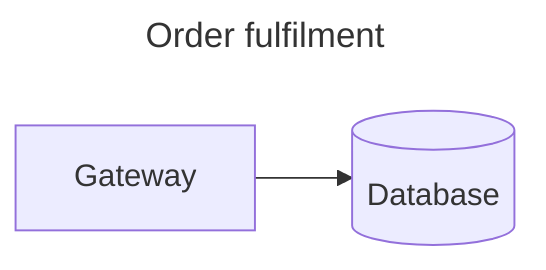

# merpeeps-mermaid-layout

**Save node positions and styling for Mermaid diagrams inside the diagram file
— and render them.**

A Mermaid layout plugin, plus the metadata format behind it. Part of the
[Merpeeps project](https://github.com/sargeMonkey/merpeeps), which also provides a
visual editor for placing the boxes in the first place.

```bash
npm install merpeeps-mermaid-layout
```

## The problem

Mermaid has no coordinate system. Positions are derived by the layout engine at
render time, so there is nowhere in the syntax to say *"this node goes here"*.
Every visual editor built on Mermaid runs into the same wall, and each one
invents its own private way to remember an arrangement — a sidecar file, a
database row, a proprietary format. None of them interoperate, and the moment
you leave that editor, the arrangement is gone.

## The approach

Put the metadata in the file, under an unknown YAML frontmatter key.



Mermaid ignores frontmatter keys it does not recognise, so this file renders
**byte-for-byte identically** to the same file without the `x-merpeeps` block. Your
editor reads the positions; every other tool sees a perfectly ordinary Mermaid
diagram; git sees a readable text diff.

This is verified, not assumed — see [Verification](#verification).

## Usage

```js
import { getPositions, setPositions, validate, strip } from 'merpeeps-mermaid-layout';

const src = `flowchart LR\n    a[Start] --> b[End]\n`;

// Remember an arrangement.
const saved = setPositions(src, {
  a: { x: 0,   y: 0 },
  b: { x: 220, y: 0 },
});

// Read it back.
getPositions(saved);        // → { a: { x: 0, y: 0 }, b: { x: 220, y: 0 } }

// The diagram itself is untouched.
strip(saved) === src;       // → true

// Check the invariants without a renderer.
validate(saved).ok;         // → true
```

### API

| Function | Purpose |
|---|---|
| `getPositions(src)` | Node positions keyed by node id |
| `setPositions(src, positions, opts?)` | Write positions, replacing any existing layout |
| `getStyles(src)` / `setStyles(src, styles)` | Per-node fill, stroke, icon and so on |
| `parse(src)` / `serialise(src, merpeeps, opts?)` | The raw metadata block |
| `inject(src, patch)` | Deep-merge a partial update |
| `strip(src)` | Remove all metadata — plain Mermaid again |
| `bodyOf(src)` | Diagram body only, metadata removed |
| `staleIds(src, knownIds)` | Positions whose node no longer exists |
| `validate(src)` | Check the offline invariants |

From `merpeeps-mermaid-layout/mermaid`:

| Function | Purpose |
|---|---|
| `registerMerpeepsLayout(mermaid)` | Register the layout algorithm once |
| `renderWithLayout(mermaid, id, src, el?)` | Render honouring stored positions and styling |
| `applyNodeStyle(nodeEl, style)` | Paint one already-rendered node |
| `styleSvg(svg, styles)` | Apply stored styling to a rendered SVG string |

Full type definitions ship with the package.

## Rendering at the stored positions

Storing an arrangement is only half of it — something has to *draw* it. The
package ships a mermaid layout plugin, so any mermaid-based viewer can honour a
saved layout **and its styling** instead of re-deriving one:

```js
import mermaid from 'mermaid';
import { registerMerpeepsLayout, renderWithLayout } from 'merpeeps-mermaid-layout/mermaid';

registerMerpeepsLayout(mermaid);

const { svg } = await renderWithLayout(mermaid, 'diagram-1', source);
```

`renderWithLayout` falls straight through to `mermaid.render` when a document
stores no positions, or when it uses subgraphs (cluster bounds are not
determined by node positions alone). Stored styling is applied on either path,
so the result is never worse than stock mermaid.

The layout selection is injected **in memory only** and never written to your
file. A document that depends on a plugin being installed is exactly the
lock-in this format exists to avoid.

### Why it needs the `renderWithLayout` wrapper

A registered mermaid layout algorithm receives a `LayoutData`, not the source
text, and mermaid drops unknown frontmatter keys before that point — so the
algorithm cannot read the Merpeeps block itself. It does receive `diagramId`, and the
caller has both the id and the text, so the wrapper bridges the two. This was
established by probing a live mermaid build, not by reading its types.

### Styling

Stored `fill`, `stroke`, `strokeWidth`, `dashed` and `text` are painted onto the
rendered SVG rather than pushed through mermaid's `style`/`classDef` syntax.
Writing style into the diagram body would change the file, and the whole point
of Merpeeps is that presentation can be stored *without* touching what the diagram
says.

### Two carriers

Frontmatter is the default and works for every diagram type. Some hosts strip
frontmatter, so a comment carrier is available as a fallback:

```js
serialise(src, merpeeps, { carrier: 'comment' });
// → …\n%% merpeeps1 {"spec":1,"layout":{…}}
```

Mermaid's `@{ ... }` node metadata was considered and rejected as the primary
carrier: it is **flowchart-only**, unavailable in C4, architecture and the other
graph types.

## Guarantees

1. **The body is never modified.** Writing metadata is byte-preserving; the
   diagram text you wrote is the diagram text that stays on disk.
2. **Writing twice converges.** No churn in git from repeated saves.
3. **Nothing leaks into the rendered output.** No metadata token appears in the
   SVG a stock renderer produces.
4. **Stale entries are reported, never deleted.** Renaming a node in text does
   not silently destroy the layout you arranged — `staleIds` tells you, and you
   decide.

## Verification

The degradation claim is the one everything else depends on, so it is measured
rather than asserted. The reference suite renders every Mermaid diagram type
twice — once plain, once with metadata attached — in a real browser, and
compares the results.

Against **Mermaid 11.16.1**:

| Claim | Result |
|---|---|
| Unknown frontmatter keys are ignored | ✅ every diagram type |
| `%%` comments are ignored | ✅ every diagram type |
| Extended file renders identically to the plain file | ✅ 30 / 30 renderable types |
| No metadata reaches the rendered surface | ✅ zero leaks |

Two details worth knowing if you build your own checker: leak detection must
scan the *user-visible* text rather than the raw SVG, because short numeric
tokens collide with floating-point path data; and a few diagram types are
non-deterministic between renders, so a baseline has to be rendered twice before
a difference can be blamed on your change.

## Scope

This package is the **storage contract** plus a renderer that honours it. It
stores positions and can draw them; it does not *compute* them. That is
deliberate — the value is in every tool agreeing on where an arrangement lives,
and shipping a layout algorithm would only invite disagreement about which one
is best. Bring your own layout, or a user's mouse.

### Not an alternative to `@mermaid-js/layout-elk`

Merpeeps registers through the same plugin interface as the official
[`@mermaid-js/layout-elk`](https://www.npmjs.com/package/@mermaid-js/layout-elk)
and [`@mermaid-js/layout-tidy-tree`](https://www.npmjs.com/package/@mermaid-js/layout-tidy-tree),
which makes them look like competitors. They solve opposite halves of the
problem:

| | Official layout plugins | Merpeeps |
|---|---|---|
| Input | Graph structure | Stored coordinates |
| Output | A computed arrangement | The arrangement that was saved |
| Author intent | Cannot be expressed | Is the whole input |
| Reads externally supplied positions | No | Yes, that is the point |
| Size | 15 MB (elk) · 242 KB (tidy-tree) | 17 KB |

ELK and tidy-tree are *better algorithms*. Merpeeps is *no algorithm* — it
reproduces a decision a person already made. Use them together: let ELK do the
first pass, move the few nodes it got wrong, and save the result.

The format is specified in [`SPEC.md`](./SPEC.md). Implementations exist in
JavaScript (this package) and C#, checked against a shared conformance suite so
the two cannot drift apart.

## Licence and names

MIT — see [`LICENSE`](./LICENSE).

**Not affiliated with, endorsed by, or sponsored by Mermaid Chart Inc. or the
Mermaid open-source project.** "Mermaid" is used here only to describe the file
format this tool reads and writes.

---

## Part of Merpeeps

| | |
|---|---|
| [Repository](https://github.com/sargeMonkey/merpeeps) | Source, issues, and the full story |
| [Visual editor](https://github.com/sargeMonkey/merpeeps/blob/main/docs/GUIDE.md) | A desktop app for placing the boxes — this package renders what it saves |
| [SPEC.md](SPEC.md) | The stored format, and what a reader must do with it |

MIT licensed. Not affiliated with, endorsed by, or sponsored by Mermaid Chart
Inc. or the Mermaid open-source project.
## Explicit rendered geometry

This JavaScript package is the Merpie **companion**, not an equivalent port of
the C# typed authoring engine. It does not implement 33-family parsing/edit
commands or ship a desktop/browser editor. Core authoring stays in .NET.

The prerelease adds typed browser geometry exports:

```js
import { harvestRenderedGeometry } from 'merpeeps-mermaid-layout/geometry';
const geometry = harvestRenderedGeometry(document.querySelector('svg'));
```

The CLI's opt-in `adopt --geometry` path stores a Flowchart's rendered dimensions,
group frames, line-level label placement and sampled connector paths under
`x-merpeeps.layout.rendered`. `renderWithLayout` replays that complete snapshot
instead of falling back to automatic layout for grouped diagrams.

The self-contained `merpeeps preview` page exposes
`await window.merpeepsHarvestGeometry()` for capturing the visible SVG. Source
identities/content and ownership must match the captured scene. Stale content,
sizes, memberships or endpoint arrangements are reported explicitly; re-adopt
when reference fidelity is needed after structural edits. Legacy position-only
files and stock Mermaid behavior remain unchanged.

Coordinates are in SVG diagram units. Curves use sampled polylines, and native
fonts/shape details are not a promise of pixel-identical browser rasterization.
